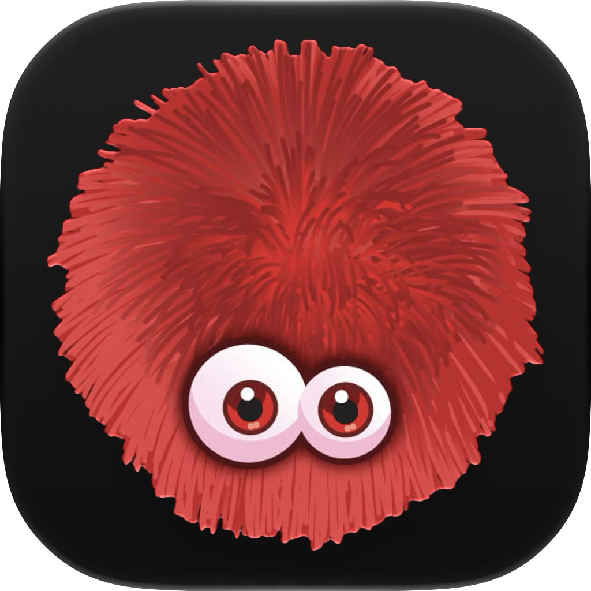
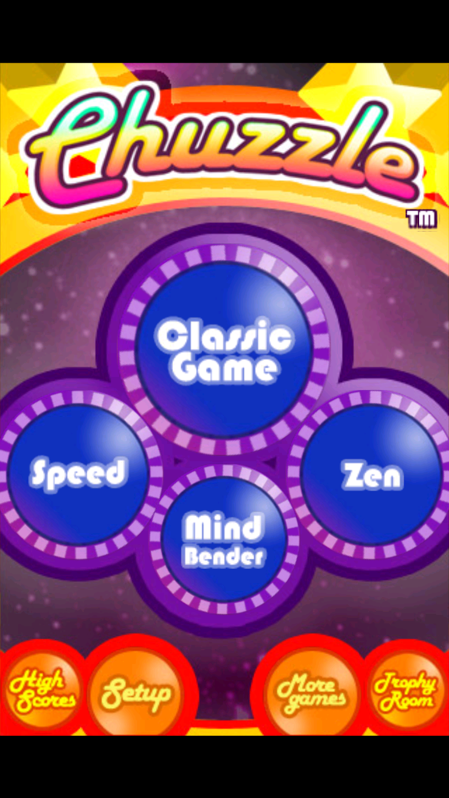
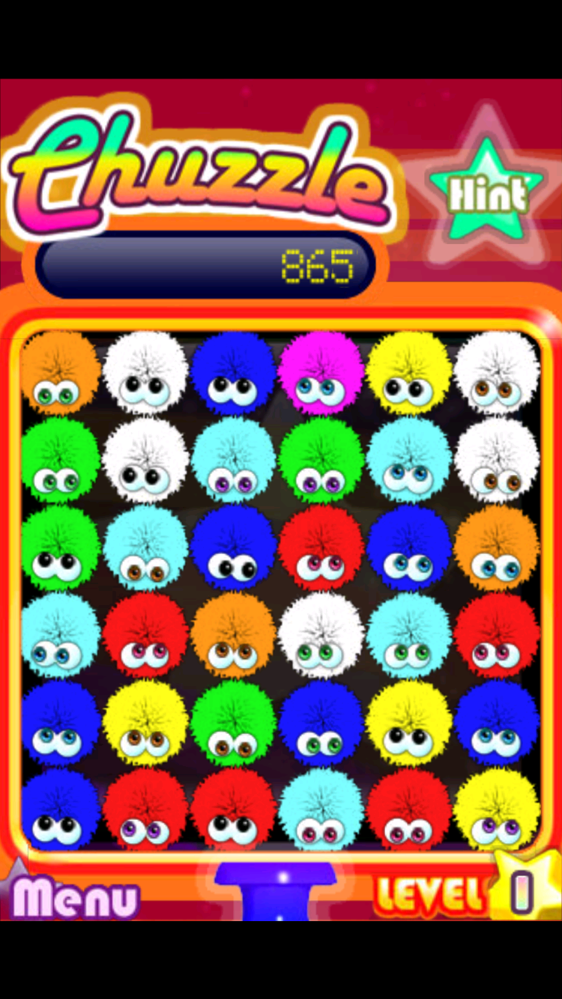

  

# Respring — Chuzzle

The original iPhone Chuzzle experience, brought forward to modern iPhones and iPads as part of **Respring**, a project restoring classic iOS apps.

This preservation project runs the original game logic through ahead-of-time ARM/Thumb-to-ARM64 translation, with a modified touchHLE compatibility runtime providing the old iOS APIs. It preserves the original artwork, sounds, game modes, and 3.5-inch iPhone layout.

  
  

## What works

- Classic, Speed, Zen, and Mind Bender use the original game implementation.
- The original 2:3 play area stays centered by default. Optional **Fill Screen (Cropped)** in Settings enlarges it uniformly to fill the screen, cutting off content at the edges.
- iOS 27.1 native window resizing supports Duo displays and rotation without the older scaled compatibility window.
- **Use Full Resolution** is on by default; turn it off to render at 320×480. Force quit and reopen after changing either setting.
- The display stays awake while the game is active. The Home gesture works normally without an extra swipe.
- Rendering scales automatically to cover the display's backing resolution, including iPad More Space scaling. The original low-resolution artwork is unchanged.
- Gameplay targets 60 FPS, preserving the original animation timing.
- Backgrounding pauses the game and audio; returning resumes play.
- Preferences use atomic writes when requested by the original app. Runtime logs are bounded, and detailed performance metrics are off by default.
- The app uses an editable Icon Composer icon.

This is a community preservation build, not an official PopCap or EA release. It is not a reconstruction of the game in Swift, and it is not a complete source-code decompilation. Shipping builds do not contain an executing CPU interpreter or JIT fallback; a compatibility layer still supplies legacy APIs and the original memory layout.

## Installation

Download **Chuzzle.ipa** from [Releases](https://github.com/DylanMcD8/respring-chuzzle/releases). It is an **unsigned ARM64 device IPA**: use your own signing/sideloading workflow to sign it for your device. Opening the download alone will not install it. Signing validity and supported devices depend on the certificate and provisioning method you use.

Alternatively, build and run **Chuzzle.xcodeproj** with your own Apple development team. No development certificate, provisioning profile, or device list is included.

The deployment target is iOS/iPadOS 15.0. Testing has focused on recent OS versions, an iPhone 18 Pro simulator, and a 13-inch M4 iPad Pro; older supported OS versions have not all been tested. The simulator build currently targets Apple silicon Macs.

## Build from source

You need a Mac with full Xcode, Python 3, Rust, and CMake. The tested tools are Xcode 27.1, Rust 1.99.0, and CMake 4.3.5. Rust is pinned in `rust-toolchain.toml`; crate sources and the modified SDL2 source are included.

1. Install the Rust toolchain and both Apple ARM64 targets described in [BUILDING.md](BUILDING.md).
2. Open `Chuzzle.xcodeproj`, select the **Chuzzle** scheme and your destination.
3. For a physical device, choose your own development team in Signing & Capabilities and use an available bundle identifier.
4. Build and run. The first build compiles the translation and may take a while.

See [BUILDING.md](BUILDING.md) for command-line builds, unsigned IPA packaging, diagnostics, and the source layout.

## Resolution and limitations

Game coordinates remain 320×480. The render target uses the smallest integer scale covering the display-backed play area, capped at 8×, and is resolved to the display. This avoids enlarging a finished 320×480 frame while preserving layout and input behavior. The selected target depends on the screen configuration reported by iOS; More Space can request more pixels than the physical panel contains. This is not an HD asset pack: textures, bitmap text, and sprites still have their original detail. See [rendering and performance notes](docs/RENDERING.md) for the presentation path, measured iPad results, and simulator limitations.

The game runs at 60 updates per second. Requesting 120 display frames does not create intermediate animation frames, so 120 FPS is not enabled by default. There is no cloud-save integration. Original game-file writes retain their original format and behavior; Foundation atomic-write fixes do not make every original save operation transactional.

## Credits and licensing

Chuzzle and its original game content belong to their respective rights holders. The game executable, translated game instructions, artwork, audio, icon imagery, and screenshots are not relicensed by this repository's open-source notices. This project claims no affiliation with or endorsement from PopCap or EA.

The compatibility runtime derives from [touchHLE](https://github.com/touchHLE/touchHLE), with changes for static translation, iOS hosting, presentation, frame pacing, and lifecycle handling. Its MPL-2.0 notices are preserved. SDL2, Rust dependencies, fonts, and bundled runtime libraries retain their own licenses.

See [LICENSE.md](LICENSE.md), [THIRD_PARTY_NOTICES.md](THIRD_PARTY_NOTICES.md), and the license files beside their sources. Release source archives accompany the IPA, including the upstream sources identified for the bundled GNU runtime libraries.
