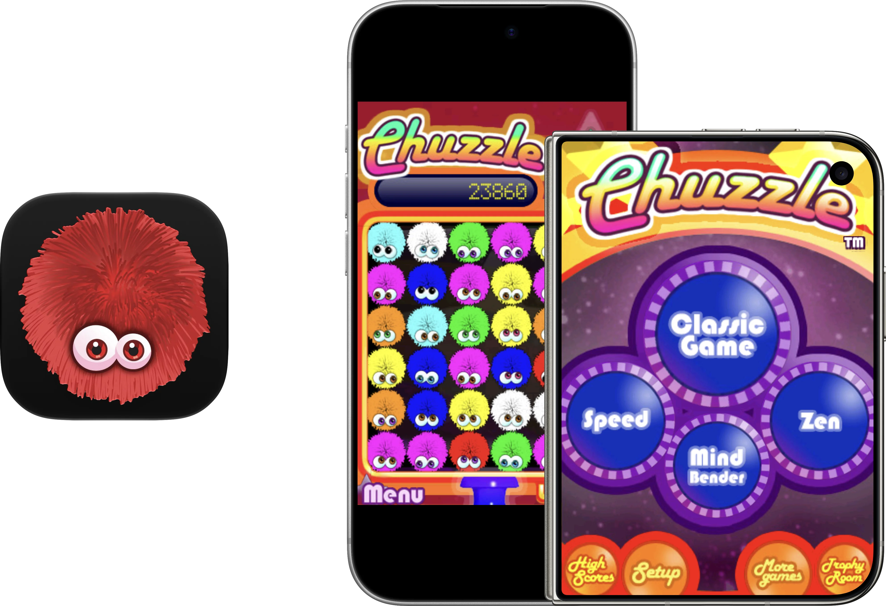

  

# Respring – Chuzzle
Chuzzle was one of my favorite iPhone apps back in the day. I have long wanted to have it on my modern devices, but it's a 32-bit app that was never updated for anything past iPhone OS 2. So, with the help of Codex (GPT-6 Astra and GPT 6.1 Sol), you can once again play Chuzzle on any modern iOS device!

### How does it work?
This new build runs the original game logic through ahead-of-time ARM/Thumb-to-ARM64 translation, with a modified touchHLE compatibility runtime providing the old iOS APIs. It uses all of the original artwork, sounds, game modes, etc. No JIT required!

### Enhancements
- Full Resolution: the app now renders at full resolution. While the source images and artwork are still quite low-resolution (they were designed for iPhone 3G, after all), this does provide a slight boost in visual quality.
- Fill Screen: if you are using iPhone Duo, you'll notice that the aspect ratios of the displays are very close to that of a 3.5-inch iPhone. This option fills the screen so you don't have slight black bars on the side.
- 60 FPS: while the original game did target 60 FPS, it never had the hardware for it. Now it does!
- App Icon: I have "remastered" the app icon with Icon Composer with full support for Default, Dark, Clear, and Tinted modes.

### Notes
- The app enhancements can be enabled or disabled in Settings → Apps → Chuzzle
- The app relies on using the 3.5-inch iPhone aspect ratio. This new build doesn't attempt to change or "fix" that.
- It's not perfect! There may still be crashes. If you experience a crash or some other issue, please open an Issue on this repository.

As stated before, this project was achieved through the usage of generative AI. Outside of this README and Releases release notes, most things were written by an AI agent.

## How to Install
Download **Chuzzle.ipa** from [Releases](https://github.com/DylanMcD8/respring-chuzzle/releases). It is an **unsigned ARM64 device IPA**: use your own signing/sideloading workflow to sign it for your device. I recommend [Sideloadly](https://sideloadly.io).

Alternatively, you can build and run **Chuzzle.xcodeproj** with your own Apple development team. 

The deployment target is iOS/iPadOS 15.0. Testing has focused on recent OS versions, an iPhone 18 Pro simulator, and a 13-inch M4 iPad Pro; older supported OS versions have not all been tested. The simulator build currently targets Apple silicon Macs.

## Build from Source
*Written by AI agent*
You need a Mac with full Xcode, Python 3, Rust, and CMake. The tested tools are Xcode 27.1, Rust 1.99.0, and CMake 4.3.5. Rust is pinned in `rust-toolchain.toml`; crate sources and the modified SDL2 source are included.

1. Install the Rust toolchain and both Apple ARM64 targets described in [BUILDING.md](BUILDING.md).
2. Open `Chuzzle.xcodeproj`, select the **Chuzzle** scheme and your destination.
3. For a physical device, choose your own development team in Signing & Capabilities and use an available bundle identifier.
4. Build and run. The first build compiles the translation and may take a while.

See [BUILDING.md](BUILDING.md) for command-line builds, unsigned IPA packaging, diagnostics, and the source layout.

## Credits and Licensing
Chuzzle and its original game content belong to their respective rights holders. The game executable, translated game instructions, artwork, audio, icon imagery, and screenshots are NOT relicensed by this repository's open-source notices. This project claims no affiliation with or endorsement from PopCap, Raptisoft, or EA.

The compatibility runtime derives from [touchHLE](https://github.com/touchHLE/touchHLE), with changes for static translation, iOS hosting, presentation, frame pacing, and lifecycle handling. Its MPL-2.0 notices still apply. SDL2, Rust dependencies, fonts, and bundled runtime libraries retain their own licenses.

See [LICENSE.md](LICENSE.md), [THIRD_PARTY_NOTICES.md](THIRD_PARTY_NOTICES.md), and the license files beside their sources. Release source archives accompany the IPA, including the upstream sources identified for the bundled GNU runtime libraries.x
